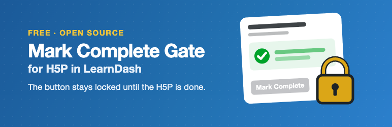

# Mark Complete Gate for H5P in LearnDash

A free WordPress plugin: LearnDash's **Mark Complete** button stays locked until the learner has completed every H5P activity on the lesson or topic.

**Page:** https://aikellogg.com/#/mark-complete-gate · **Download:** [mark-complete-gate-for-h5p.zip](https://github.com/pfkellogg/mark-complete-gate-for-h5p/releases/latest/download/mark-complete-gate-for-h5p.zip) · coming soon to the WordPress.org plugin directory.

- No setup: every lesson and topic with H5P is gated; pages without H5P are left alone.
- A scored activity counts once it's passed; several activities must all be done.
- Works with H5P in its iframe: it listens to H5P's own xAPI completion events.
- Per page: `[mark_complete_gate ignore="3,7"]` or `[mark_complete_gate off]`.
- A clean slate: when a user is permanently deleted, their H5P scores, saved progress and activity log are deleted too.

The lock is client-side. For gating the server enforces, see H5P Gating & Scoring for LearnDash (a separate, paid plugin).

Requires WordPress 6.0+, PHP 7.4+, H5P and LearnDash. GPL-2.0-or-later. H5P is a registered trademark of H5P Group; LearnDash is a trademark of its owner; this plugin is independent and not made or endorsed by either.
